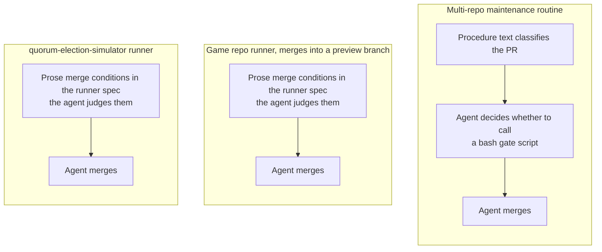
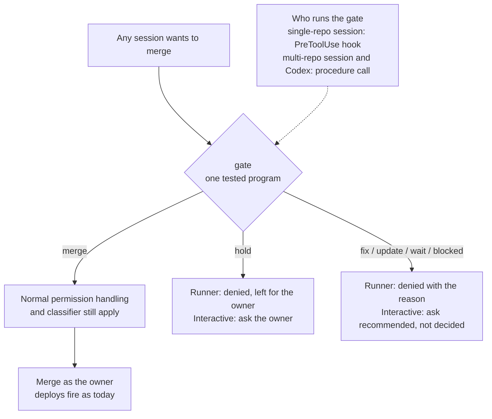
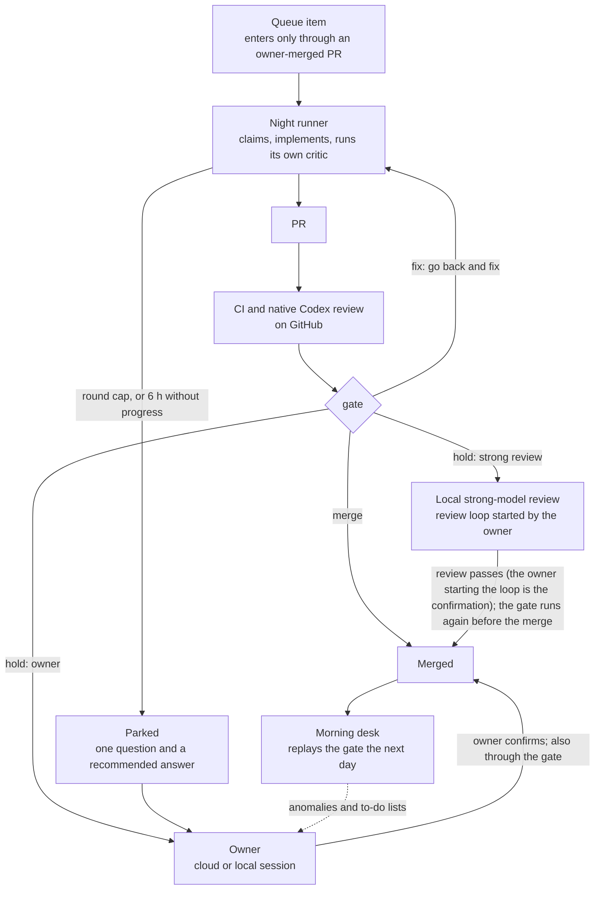
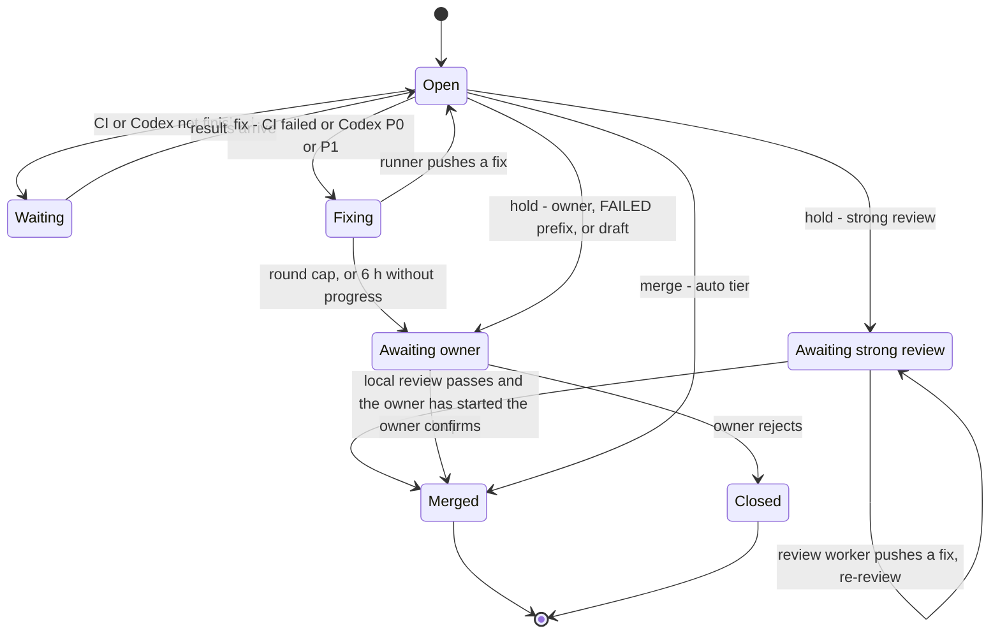
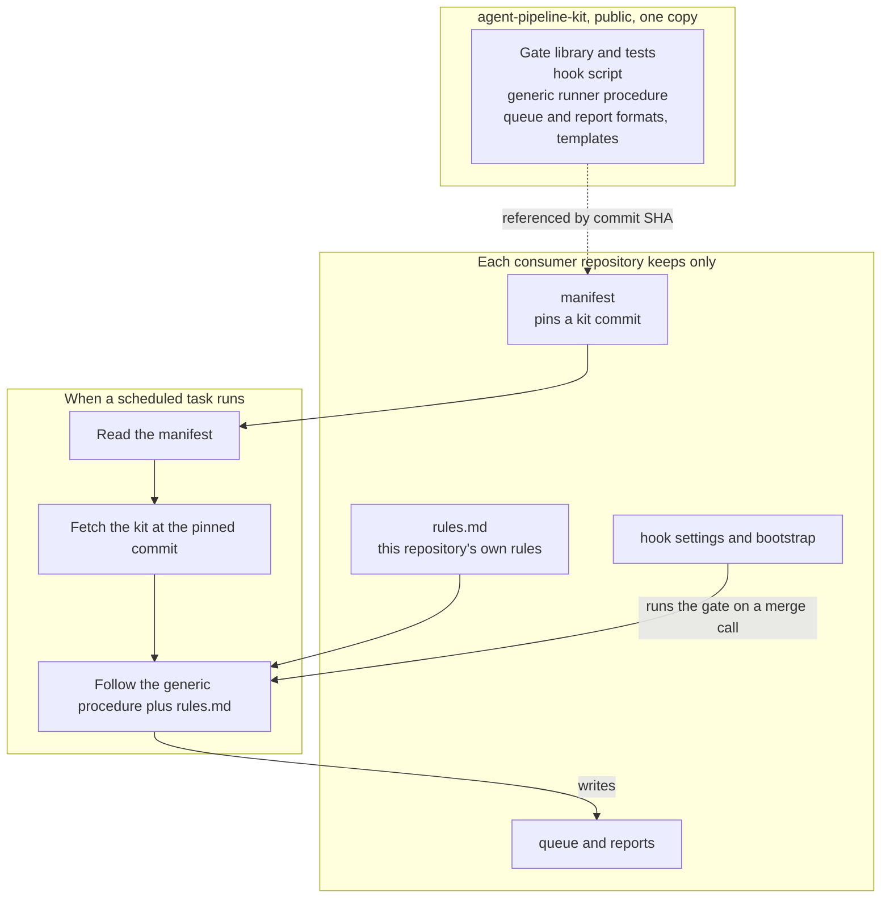

# agent-pipeline-kit

One merge gate for unattended coding-agent pipelines that run on GitHub.

A solo developer runs unattended agent sessions in several repositories: a
night runner picks queued work, opens pull requests, fixes review findings and
merges a pull request when it is safe to. Before this kit, each repository
wrote its merge decision its own way: two as prose in a runner specification
that the agent reads and judges, one as a bash script that the agent itself
decides whether to call. This kit replaces those three with one tested
program, the **gate**: a pure function that returns a verdict for a pull
request, called at the moment of the merge, and replayed the next day to
check every merge that happened.

## Stance: a guardrail with detection, not a boundary

Read this before anything else.

- The agent acts on GitHub as the owner. Its pull requests, merges and
  settings changes carry the owner's identity, so GitHub cannot tell the agent
  from the owner. An approval label, the draft flag or a comment are all
  writable by the agent in one call.
- On GitHub's free plan, private repositories have no rulesets or branch
  protection. Nothing on GitHub stops a direct push to their default branch.
  Public repositories can have rulesets, but an administrator, which the agent
  is, can turn one off with one call.
- So the gate cannot be a boundary the agent is unable to cross. It is a
  guardrail: it makes the merge decision deterministic, tested and identical
  across repositories, runs it where the merge call is made, and a morning
  replay detects merges that should not have happened. The design names every
  known way around it ([threat model](docs/threat-model.md)).
- What would make it a boundary (a separate GitHub identity for the agent) is
  listed as an optional upgrade, deferred and not built.

## How the pieces fit

**Where the merge decision is made today:**



**With the kit:**



When the verdict is `merge`, the hook returns no decision at all, so the
session's ordinary permission rules and its auto-mode classifier still apply.
The merge is still made with the owner's identity, so push-triggered workflows
and deploys behave as they do today.

**Three lanes share the gate:** the unattended night runner, a local
strong-model review loop that the owner starts, and the owner's own
convergence from a cloud or local session.



**States a pull request goes through.** Each main transition corresponds to
one verdict class (`update:base` and `blocked` are not drawn):



**What is shared and what stays in each repository:**



The kit is public because a cloud session that has one repository attached can
fetch only public repositories anonymously, and attaching the kit as a second
repository would switch that session's repository hooks off. The kit holds no
secrets and needs none.

## Status: Phase 1

| Piece | State |
| --- | --- |
| Design, threat model, decisions, open questions, review brief, implementation plan, research note | Written (this directory's `docs/`) |
| Gate library (pure verdict function, Codex review parser, path rules, manifest validation) | Implemented in `src/core/`, specified in [the implementation plan](docs/implementation-plan.md); tests in `test/core/` |
| Input collector, replay and backtest CLI | Implemented in `src/collect/` and `src/cli.js`; tests use fake `git` and `gh` runners |
| Content rules in the manifest, the path check without a pull request, and the hook's reading of the same policy | Specified in [the design](docs/design.md); slices 2 to 4 of [the implementation plan](docs/implementation-plan.md#9-slice-2-content-rules-in-the-core); not implemented |
| PreToolUse hook adapter and bootstrap | Specified in [the design](docs/design.md) only; a later slice |
| Phase 0 hook checks | A reviewed kit in `probes/phase0/`; never run |
| Manifest file format, `rules.md` and onboarding templates | Specified in the design; the on-disk format is an [open question](docs/open-questions.md); a later slice |
| Generic runner procedure | Not specified here yet; a later slice |

No consumer repository calls the kit yet. Phase 1 ends with a backtest of the
gate against merged pull requests of the consumers and a daily replay; the
gate does not intervene in any merge during Phase 1.

## Layout

```text
README.md                    this file
LICENSE                      MIT
docs/design.md               canonical design: verdicts, inputs, trust, invocation, replay
docs/threat-model.md         threats, what is and is not protected, residual gaps
docs/decisions.md            dated owner decisions and rejected designs
docs/open-questions.md       unsettled items, kit-level or per-repository
docs/review-brief.md         brief for an external reviewer of the current change
docs/implementation-plan.md  module layout, signatures, data shapes, CLI contract, tests, later slices
docs/research/               outside practice behind the path, signal and extension design
probes/phase0/               reviewed, never-run kit for the hook checks of design section 8.5
```

```text
package.json                 type module, no dependencies; `npm test` runs `node --test`
src/core/                    pure: verdict function, Codex parser, path patterns, manifest
src/collect/                 adapters: process runner, `gh api` reads, git reads, input collector
src/cli.js                   evaluate | replay | backtest
test/                        table-driven tests, fixtures, shared test builders (test/support)
.github/workflows/ci.yml     `node --test` on pull requests and pushes to main
```

Node.js 22, ESM, no runtime or development dependencies, tests with
`node:test`. Run the tests with `node --test`. The CLI needs `git` and an
authenticated `gh`, and a local clone of the consumer to fetch into (it never
checks anything out); see the usage lines in the
[implementation plan](docs/implementation-plan.md#5-cli-contract).

## License

MIT. See [LICENSE](LICENSE).
