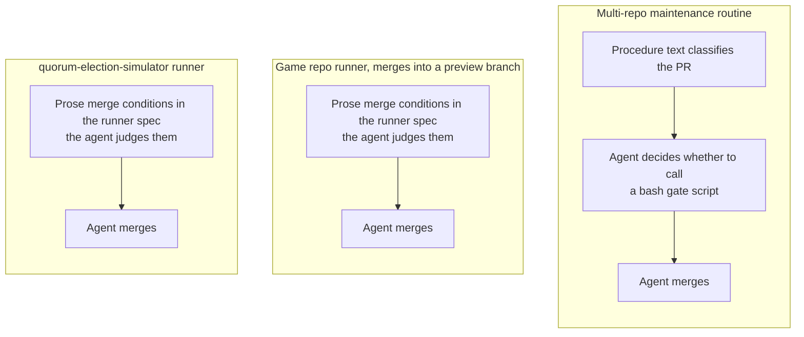
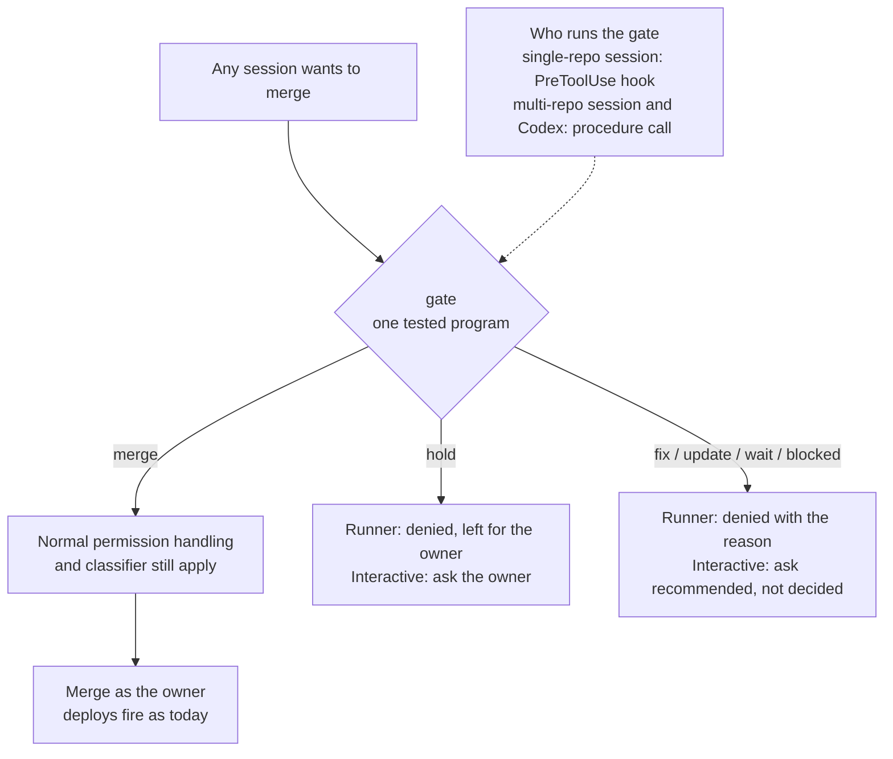
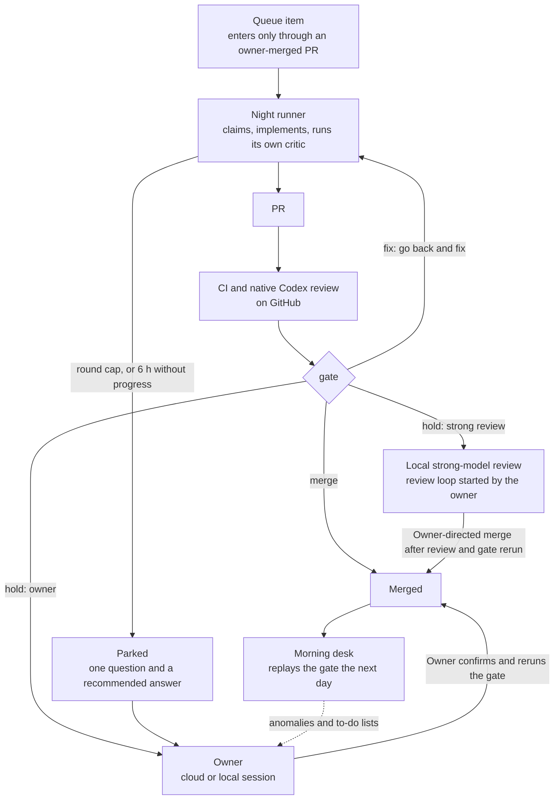
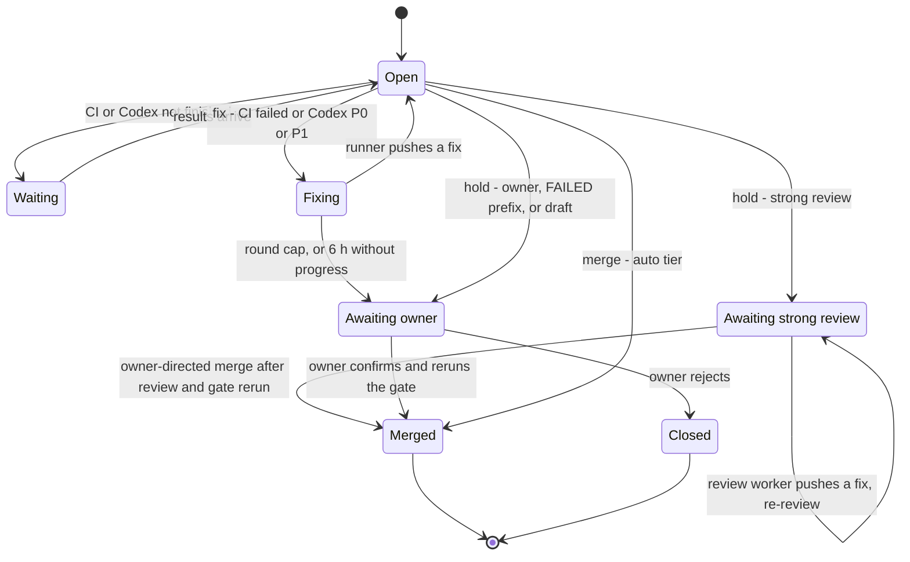
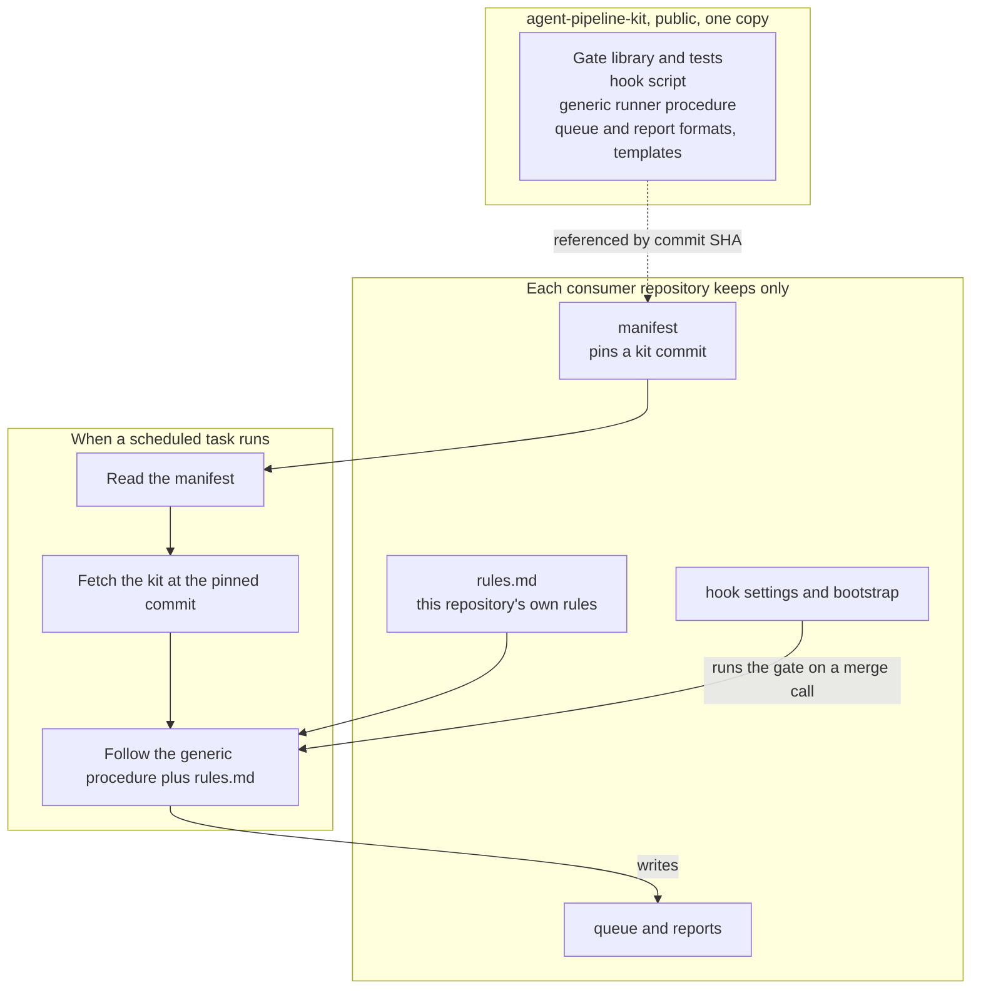

# agent-pipeline-kit

A command-line merge gate for coding-agent pipelines on GitHub. It evaluates a pull request against repository policy, GitHub Actions checks, and Codex review evidence for the PR head. Use it before a merge or to audit merged pull requests.

## Migration target

These diagrams record the workflow that consumer repositories are moving toward. The first shows where they started.

### Before migration

Three runners made merge decisions independently.



### Shared gate

The caller runs the gate and handles the verdict. A `merge` verdict lets the caller proceed through its normal permission checks. The hook is a planned adapter. Use an explicit procedure call in environments where the hook probe cannot establish reliable coverage.



### Workflow

The night runner, local review loop, and owner session share the gate. Keep one existing runner per queue. The caller reruns `evaluate` after review or owner confirmation and immediately before merging, then requires the merge to match the reviewed head SHA. Owner confirmation and strong review resolve holds in the owner-directed path. Unattended merges require a `merge` verdict. The operator schedules morning replay. Direct-push detection and GitHub control drift checks are planned.



**Pull request states in the target workflow.** These transitions describe actions taken by the caller and owner. The diagram omits `update:base` and `blocked:*`.



### Repository layout

The target includes planned hooks, bootstrap, and a shared runner procedure. The bootstrap checks that the pinned kit commit is reachable from the kit’s default branch before executing it, and the owner approves pin changes. Keep the consumer as the sole attached repository for a hook-based session and fetch the public kit anonymously at its pin. Vendoring is the fallback if the cloud probe shows that fetch is unavailable. The public kit uses synthetic or public fixtures. Private consumer names, account and deployment settings, queue and report data, and secrets stay outside it. Existing GitHub controls stay in force. The current CLI reads the manifest and returns verdicts.



### Shared policy and cutover

The target policy combines an immutable kit floor with a consumer allowlist that defaults to a hold. Three readers share the kit floor and the consumer manifest: the current PR evaluator, the planned path check without a PR, and the planned runner hook. For write and push checks, the hook enforces only the floor patterns marked for that purpose.

Start by backtesting and running the gate in shadow mode. During overlay, require both the existing rules and the gate to allow an unattended merge. Switch only after every existing hold has equivalent coverage or an explicit, recorded retirement, the path check without a PR exists, and the branch used to read policy is settled. Then replace duplicated rules with a pointer to the shared policy. [Historical path-check plan](https://github.com/yusaanthya/agent-pipeline-kit/blob/7d311aba10120e0ebd1026700e8e07e62b81f878/docs/implementation-plan.md#10-slice-3-the-path-check-without-a-pull-request) · [Historical hook plan](https://github.com/yusaanthya/agent-pipeline-kit/blob/7d311aba10120e0ebd1026700e8e07e62b81f878/docs/implementation-plan.md#11-slice-4-the-hook-reads-the-same-policy) · [Historical open questions](https://github.com/yusaanthya/agent-pipeline-kit/blob/7d311aba10120e0ebd1026700e8e07e62b81f878/docs/open-questions.md)

## Run the gate

Use Node.js 22 or newer, Git, and an authenticated GitHub CLI (`gh`) with read access to the target repository. Use a trusted local clone of the target repository with `origin` pointing to that same repository and enough history to resolve the relevant commits. There are no npm dependencies to install.

Run from the kit checkout and replace the repository, PR number, clone path, and dates with your own values. These commands assume a configured queue lane targeting `preview`. For live evaluation, pick an open PR with a `claude/item-<id>` head. For replay, pick a merged PR.

```sh
node src/cli.js evaluate --repo OWNER/REPO --pr 123 --repo-dir /path/to/repo
node src/cli.js replay --repo OWNER/REPO --pr 122 --repo-dir /path/to/repo
node src/cli.js backtest --repo OWNER/REPO --repo-dir /path/to/repo --since 2026-11-01 --until 2026-11-08 --base preview
npm test
```

- `evaluate` checks a live PR. Pass `--lane` for a caller lane. A configured queue lane is inferred from a `claude/item-<id>` head branch.
- `replay` reconstructs a verdict for one merged PR. A caller lane is inferred from an exact `Auto-Merged-By:` line in the merge commit message that identifies one configured caller lane. Before cutover, configure every merging routine to stamp the lane of the PR it merges, including when another routine handles that lane.
- `backtest` runs replay for PRs merged from `--since` inclusive to `--until` exclusive. The optional `--base` filters by target branch. It emits one JSON line per PR and a final summary. `anomalies` lists marked merges with a verdict other than `merge`, and `unmarkedNotMerge` lists such verdicts on unmarked merges. PRs whose evidence collection failed appear in both lists because their marker is unknown.

`evaluate` and `replay` emit a JSON object and exit `0` for `merge` or `1` for any other verdict. `backtest` exits `0` after producing a summary even if it found anomalies, so inspect the JSON. It exits `1` if collecting the PR list fails. Invalid arguments exit `2`.

## Configure policy

Copy the example manifest and set `kit` to the kit checkout’s 40-character commit SHA. Replace `check` with the exact GitHub Actions check-run name and adapt the base branch, freeze rule, and paths to your repository. Commit it as `.agent-line/manifest.json` on the target repository’s default branch. The gate reads that file from the fetched default branch even when the PR targets another branch. [Example manifest](examples/manifest.json)

The CLI validates the `kit` field’s format. Pin the kit checkout separately for reproducible runs. `checks: "none"` requires an owner decision. `codex_clean: "no_findings"` requires a review with no findings, while `"no_blocking"` allows advisory findings. Built-in holds cover changes such as GitHub workflow files, agent configuration, and dependency manifests. Path rules match case-insensitively. `*` matches within one path segment and a `**` segment matches zero or more segments. Extra path and content holds are configurable. `hold_on_line_change` uses literal text with optional anchors at the start (`^`) and end (`$`). [Manifest validation](src/core/manifest.js) · [Content rules](src/core/content.js)

A queue lane reads `.agent-line/queue/<id>.md` from the evaluated base commit. A missing item, unreadable front matter, or `merge: owner` in the item holds the PR for the owner. For a workflow without queue branches, configure a lane with `"kind": "caller"` and pass its name with `--lane` when running `evaluate`.

All three commands accept `--manifest FILE`, which takes precedence over the policy in Git. Treat the file as trusted policy and keep it under operator control, outside the PR checkout. In `replay`, pass a separately verified copy of the policy in effect at merge time when available. In `backtest`, the same supplied file applies to every PR, so use it to evaluate a proposed policy or a window with one verified policy version. By default, replay selects a manifest from the current default branch’s first-parent history using commit timestamps as an approximation.

## Interpret results and adopt the gate

A live `merge` verdict includes the expected head SHA and the suggested squash commit message. If you integrate it into a runner, evaluate immediately before merging and require the merge operation to match that head SHA. Handle `hold:*` as an escalation, `wait:*` as pending, `fix:*` as failed checks or review, `update:base` as a stale base, and `blocked:*` as a stop. Use `reasons` for the details. Start with manual evaluation and backtests to see how the policy behaves on your repository.

The CLI queries GitHub and fetches Git objects into temporary local refs. The fetch writes to the clone’s object store. The CLI leaves the worktree untouched, reads PR contents as Git objects, and performs no GitHub writes. Merge execution, scheduling, hooks, and enforcement belong to the caller or repository configuration. Anyone with sufficient repository permissions can bypass the gate or change its inputs. A merge marker is a convention for auditing and lane selection. GitHub permissions and branch controls govern enforcement.

Cloud hook behavior remains unverified. The Phase 0 probe has passed local syntax and dry-run checks and has yet to run in a cloud session. [Phase 0 probe](probes/phase0/README.md)

Historical results are best-effort. Replay needs the PR head and a reachable merge commit and uses the merge commit’s first parent as the historical base. For a multi-commit PR merged by rebase, that parent can be an intermediate rebased commit. Replay can evaluate against that base without flagging the limitation in `limits`. Historical halt labels, freeze PR retargeting, and later review edits can also affect reconstruction. Inspect `limits` alongside each verdict. Backtest enumerates merged PRs, so use a separate audit if you also need to detect direct branch pushes.

## License

[MIT](LICENSE)
